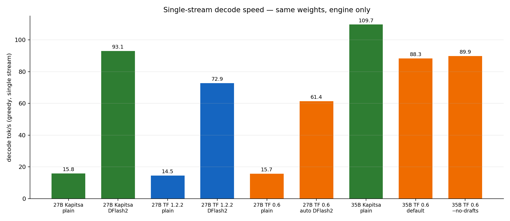
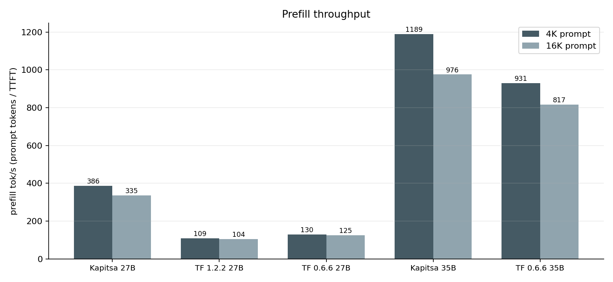
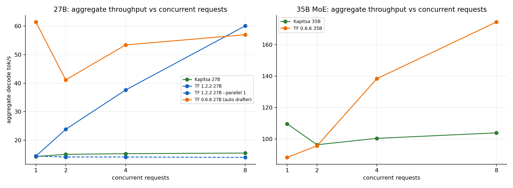
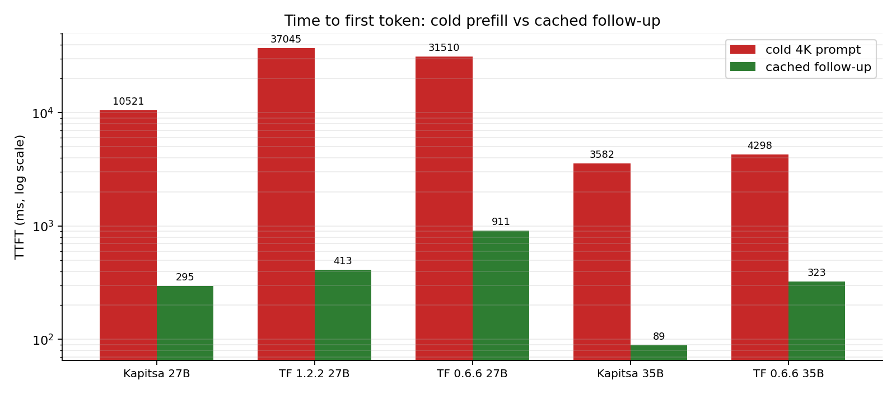

# TensorFold vs Kapitsa — An In-Depth Benchmark on the Same Mac with the Same Weights

[简体中文](README.md) | **English**

> Engines tested: **Kapitsa 0.2.26**, **TensorFold 1.2.2 (native Zig engine)**, **TensorFold 0.6.6 (legacy Python + MLX engine)**
> Hardware: Mac mini M4 Pro (14 CPU / 20 GPU cores / 64 GB), macOS 27.2
> Primary model: `TensorFold/Qwen3.8-27B-MLX-4bit` (14.98 GiB, 64 dense layers, with a vision tower)
> Secondary model: `mlx-community/Qwen3.5-35B-A3B-4bit` (19.5 GB, 40 MoE layers, already available locally)
> All raw data, scripts, and logs are included in this repository for reproducibility.

---

## 0. Key Findings (TL;DR)

1. **TensorFold represents two generations of engines, not a single engine.** The current 1.2.2 native engine **cannot load** the user's existing Qwen3.5-35B-A3B (`model_type=qwen3_5_moe`); only the legacy 0.6.6 engine (Python + MLX) can run it. This is the most important compatibility finding in this benchmark.
2. **On Qwen3.8-27B, which both projects support, Kapitsa delivers faster single-stream generation, a faster first token, 3.0–3.5× faster prefill, and 6 GiB less memory usage; TensorFold delivers 3.9× higher concurrent throughput through batching.**
   - Single-stream decode (plain): Kapitsa 15.8 tok/s ≈ TF 1.2.2 14.5 ≈ TF 0.6.6 15.5
   - With the same DFlash2 drafter: **Kapitsa 93.1** > TF 1.2.2 72.9 > TF 0.6.6 61.4 tok/s
   - 4K prefill: **Kapitsa 386** > TF 0.6.6 130 > TF 1.2.2 109 tok/s
   - Cached TTFT: **Kapitsa 295 ms** < TF 1.2.2 413 ms < TF 0.6.6 911 ms
   - Aggregate throughput at 8 concurrent requests: **TF 1.2.2 60.0** > TF 0.6.6 57.0 > Kapitsa 15.5 tok/s
3. **For the 35B MoE model, Kapitsa is the only fully functional option**: Kapitsa reaches 109.7 tok/s versus TF 0.6.6 at 88.3 tok/s. At 8 concurrent requests, TF 0.6.6 overtakes it at 174 tok/s (Kapitsa: 103.9), but TF 1.2.2 cannot run the model at all.
4. **Speculative decoding provides the largest performance gain, far exceeding the differences between engines**: the same DFlash2 drafter takes the 27B model from ~15 tok/s to 73–93 tok/s (5–6×). Kapitsa's KFlash tree verification is another 28% faster than TF 1.2.2. However, **the user's local 35B checkpoint has no MTP/DFlash sidecar files, so both engines are limited to plain decoding**.
5. **Both projects have feature gaps**: Kapitsa supports images, JSON Schema, Anthropic/Responses APIs, and API keys by default, but lacks `/metrics`, `/v1/completions`, and cross-request batching. TensorFold provides full `/metrics`, `/v1/completions`, batching, and context compaction, but 0.6.6 does not support `response_format`; vision in 1.2.2 requires `--vision`, and vision in 0.6.6 fails to start on this machine because torchvision is missing.
6. **The same model with greedy decoding does not guarantee identical token sequences across engines**: Kapitsa and TF 1.2.2 matched on all six prompts for 27B; TF 0.6.6 diverged on 1/6 prompts after roughly 40 tokens. Kapitsa and TF 0.6.6 matched on all six prompts for 35B. Cross-engine bitwise equivalence cannot be assumed.
7. **Quality is determined by the model, not the engine**: across 12 tasks, all three engines scored 10/12 on 27B (failing the same two tasks), and both engines scored 11/12 on 35B.
8. **Recommendations**:
   - Everyday interaction/coding with 27B or 35B, prioritizing low latency → **Kapitsa** (with DFlash2 where available).
   - 8 or more concurrent requests, Prometheus metrics, or broad OpenAI compatibility → **TensorFold 1.2.2**, provided the model is supported.
   - Must run Qwen3.5-35B-A3B → **Kapitsa**; TensorFold requires falling back to 0.6.6.
   - Image input → Kapitsa works out of the box; TensorFold 1.2.2 requires `--vision`; 0.6.6 is unavailable for vision on this machine.

---

## 1. Engines Under Test

| | Kapitsa | TensorFold 1.2.2 | TensorFold 0.6.6 |
|---|---|---|---|
| Version | 0.2.26 (`6ef19b0`) | `tensorfold-native 1.2.2` | `tensorfold 0.6.6` |
| Installation | `brew install nace-ai/tap/kapitsa` | `brew install ashhart/tensorfold/tensorfold` | `brew install ashhart/tensorfold/tensorfold@0.6` |
| Runtime | Native Metal (no Python) | Native Zig + Metal | Python + MLX |
| License | Apache-2.0 | Apache-2.0 | Apache-2.0 |
| Focus | Qwen-focused serving on Apple silicon | General-purpose native engine for Apple silicon / NVIDIA | Previous-generation Python engine with broader model coverage |

### 1.1 Models

| Model | Architecture | Weight size | Purpose |
|---|---|---|---|
| `TensorFold/Qwen3.8-27B-MLX-4bit` | 64 dense layers, hidden size 5120, 4-bit g64, with ViT | 14.98 GiB | **Primary comparison model** (natively supported by both projects) |
| `mlx-community/Qwen3.5-35B-A3B-4bit` | 40 MoE layers, 256 experts / 8 active, hidden size 2048 | 19.5 GB | User's existing model; tests the path of using weights already on the machine |
| `qwen3.5-4b-4bit` (bundled with Kapitsa) | Dense 4B + MTP head + DFlash2 | 4.57 GB | Speculative-decoding ablation (DFlash2 vs MTP vs plain) |

> Why two comparison tracks? The user initially requested the local 35B model. Testing showed that **TensorFold 1.2.2 rejects `qwen3_5_moe`** (the error explicitly recommends falling back to 0.6), while 0.6.6 can run it but has an older feature set. The user then specified `Qwen3.8-27B-MLX-4bit`, which is supported by 1.2.2, 0.6.6, and Kapitsa. It therefore became the only model in this study suitable for a same-weights, same-machine, three-engine comparison. The 35B track remains to answer whether the user's existing local model actually works.

---

## 2. Methodology

### 2.1 Fairness Rules

- **Only one engine runs at a time.** All GPU jobs share `/tmp/tensorfold-vs-kapitsa-gpu.lock` (`flock`) to avoid GPU contention.
- Each engine warms up before measurement. Results use the median of 5 runs per configuration (3 for probes).
- **Explicit sampling settings**: `temperature=0` for greedy decoding; `temperature=0.6, top_p=0.95, top_k=20` for sampling (Qwen's recommended values).
- **Thinking is disabled consistently**: requests include both `chat_template_kwargs.enable_thinking=false` and `reasoning_effort="none"`; server-side thinking is also disabled where possible. Thinking is tested separately in an ablation.
- **Cold prompts include a nonce**: a random nonce is inserted near the start of the system message for 4K/16K prefill to prevent prefix-cache hits.
- **Decode rate uses actual token counts**: SSE event count ≠ token count (Kapitsa can combine multiple characters into one event). We divide the server's `usage.completion_tokens` by the elapsed time between the first and last token events. TTFT runs from request submission to the first content/reasoning token.
- **Cache measurement**: send a cold 4K prompt, then append three follow-up turns; report median TTFT and record `cached_tokens`.
- **Concurrency measurement**: send 2/4/8 simultaneous 256-token requests; record total wall time, aggregate tok/s, per-stream tok/s, and median TTFT.

### 2.2 Measurement Phases

| Phase | Scope |
|---|---|
| startup | Time from launch until `/health` is ready, `footprint` memory, and `/v1/models` metadata |
| decode | 512-token coding task, 5 greedy runs + 5 sampling runs |
| prefill | 4K / 16K cold prompts, TTFT and prompt tok/s |
| cached | Cold 4K prompt + 3 appended turns, TTFT and cached_tokens |
| concurrency | 2 / 4 / 8 simultaneous 256-token requests |
| longctx | Passphrase retrieval from a 22.5K-token document: correctness + TTFT |
| tools | Non-streaming tool calls, tool-result submission, and streaming tool calls |
| structured | `response_format=json_schema` and `json_object`, with JSON validation |
| thinking | Token count and elapsed time for the same math problem with thinking on/off |
| errors | Empty messages, unknown model, missing messages, oversized max_tokens, invalid role, malformed JSON |
| cancel | Disconnect a streaming request midway; check server health and subsequent requests |
| endpoints | `/v1/models`, `/health`, `/metrics`, `/v1/completions`, `/v1/responses`, `/v1/messages`, `/v1/embeddings`, image input |
| quality | 12 automatically graded tasks (arithmetic, units, code execution, JSON, instruction following, retrieval, translation, logic, dates, etc.) |
| fidelity | 6 fixed prompts, greedy decoding up to 96 tokens; record output SHA-256 for cross-engine comparison |
| sustain | Continuous decoding for 75 seconds on 35B; compare the first and last thirds and record thermal status |

### 2.3 Limitations of This Setup (Read Alongside the Results)

- **One machine, one session**: each configuration was benchmarked once, without repetition across days. M4 Pro GPU clocks and background processes can introduce a few percent of variation.
- **Loading time depends on the page cache**: Kapitsa uses mmap and loads in 2–4 seconds with a warm cache; TensorFold 0.6.6 eagerly loads weights and takes 133 seconds for 27B. Cold-cache startup was not measured because clearing the page cache requires root.
- **No wall-power measurement**: `powermetrics` requires root and was not collected. We recorded only `pmset -g therm` (nominal throughout) and performance decline over 75 seconds.
- **Concurrency was tested only up to 8 requests**, and context only up to 22.5K tokens. No second Mac was available for cluster/TP tests.
- **TensorFold 0.6.6 automatically discovers drafters in the HF cache** (z-lab DFlash2 in this setup), so its default configuration depends on cache contents. The report includes a `--no-drafts` control.
- The quality suite contains 12 custom tasks, not a standard benchmark such as MMLU/GSM8K. Its purpose is to check whether engines change model behavior, not to rank models.
- Cross-engine token-level fidelity was checked on only 6 prompts.

---

## 3. Performance Results

### 3.1 Single-Stream Decode



| Configuration | Decode tok/s (greedy) | Decode tok/s (sampling) | TTFT |
|---|---:|---:|---:|
| 27B · Kapitsa plain | 14.3 | 15.8 | 367 ms |
| 27B · Kapitsa + DFlash2 | **93.1** | — | 102 ms |
| 27B · TF 1.2.2 plain | 14.5 | 14.6 | 442 ms |
| 27B · TF 1.2.2 + DFlash2 | 72.9 | — | 320 ms |
| 27B · TF 0.6.6 plain (`--no-drafts`) | 15.5 | — | 270 ms |
| 27B · TF 0.6.6 default (automatic DFlash2) | 61.4 | 59.0 | 509 ms |
| 35B · Kapitsa plain | **109.7** | 107.5 | 64 ms |
| 35B · TF 0.6.6 default (prompt-lookup) | 88.3 | 87.4 | 102 ms |
| 35B · TF 0.6.6 `--no-drafts` | 89.9 | — | 105 ms |
| 4B · Kapitsa plain | 88.9 | — | — |
| 4B · Kapitsa MTP depth 4 | 225.4 | — | — |
| 4B · Kapitsa DFlash2 | **404.6** | — | — |

Key observations:

- Without a drafter, the dense 27B model reaches only ~15 tok/s on all three engines, with differences within the noise. **Engine differences are much smaller than the effect of having a drafter.**
- With the same z-lab DFlash2 weights, Kapitsa's KFlash (DFlash2 lattice + tree verification) is **28%** faster than TF 1.2.2 (93.1 vs 72.9).
- TF 0.6.6's automatically discovered drafter provides only a 4.0× gain (15.5 → 61.4), less than the other two engines, with noticeable Python/MLX scheduling overhead.
- The 35B MoE model has only 3B active parameters, so plain decoding already reaches ~110 tok/s. TF 0.6.6's built-in prompt-lookup drafting provides **no benefit** here (88.3 vs 89.9 with drafting disabled, a slightly negative result).
- On 4B, the KFlash progression is clear: plain 88.9 → MTP 225.4 (2.5×) → DFlash2 404.6 (4.6×).
- Measurement note: drafter-enabled rows come from probes **paired** with plain decoding (256 tokens, median of 3 runs); the baseline's 5×512-token measurements produced 14.3 for plain decoding. Ablations A1/A2/A3 therefore use their paired probe values of 15.8/14.5/15.5 as denominators, not the table's 14.3.

### 3.2 Prefill (Reading the Prompt)



| Configuration | 4K prompt tok/s | 16K prompt tok/s | 4K TTFT | 16K TTFT |
|---|---:|---:|---:|---:|
| 27B · Kapitsa | **386** | **335** | 10.6 s | 48.8 s |
| 27B · TF 1.2.2 | 109 | 104 | 37.6 s | 157.1 s |
| 27B · TF 0.6.6 | 130 | 125 | 31.5 s | 130.6 s |
| 35B · Kapitsa | **1189** | **976** | 3.4 s | 16.8 s |
| 35B · TF 0.6.6 | 931 | 817 | 4.4 s | 20.0 s |
| 4B · Kapitsa (DFlash2/plain) | ~2035 | — | 2.0 s | — |

Key observations:

- **Prefill is Kapitsa's largest individual advantage in this benchmark**: on 27B, it is 3.5× faster than TF 1.2.2 and 3.0× faster than TF 0.6.6; on 35B, it is 1.28× faster than TF 0.6.6.
- On M4 Pro, TF 1.2.2 splits 27B prompts into **128-token chunks** (startup log: "prompt chunks of up to 128 tokens"), whereas TF 0.6.6 uses 2048-token chunks for 35B. This is not a configuration issue: `TF_PROMPT_ROWS=2048` changes only row capacity; chunks remain at 128 and prefill remains at 107.7 tok/s. TensorFold's official 27B result was measured on M5 Ultra (1325 tok/s); **the M4 generation lacks the corresponding native optimization**.
- Kapitsa defaults to 2048-token prefill chunks and offloads part of the FFN work to the Neural Engine. Both 512 and 4096 make it substantially slower (see ablation A8).
- Long-context (22.5K) TTFT: Kapitsa 27B 71.7 s / TF 1.2.2 224.9 s / TF 0.6.6 183.8 s; on 35B, 25.8 s / 27.7 s. All three engines retrieved the passphrase correctly.

### 3.3 Concurrency and Batching



| Configuration | n=1 | n=2 | n=4 | n=8 | Median TTFT at n=8 |
|---|---:|---:|---:|---:|---:|
| 27B · Kapitsa (slots=4) | 14.3 | 15.1 | 15.3 | **15.5** | 11.9 s |
| 27B · TF 1.2.2 (parallel auto=8) | 14.5 | 23.9 | 37.6 | **60.0** | 1.41 s |
| 27B · TF 1.2.2 `--parallel 1` | 14.5 | 14.2 | 14.2 | **14.0** | 23.4 s |
| 27B · TF 0.6.6 (auto drafter) | 61.4 | 41.2 | 53.4 | 57.0 | 1.49 s |
| 35B · Kapitsa (slots=4) | 109.7 | 96.4 | 100.4 | **103.9** | 1.52 s |
| 35B · TF 0.6.6 | 88.3 | 95.7 | 138.3 | **174.4** | 0.43 s |

Key observations:

- **Kapitsa does not batch decoding across requests.** Every request log reports `0 cycles batched with other requests`; slots keep multiple conversations warm while the GPU serves them in turn. Aggregate throughput at 8 concurrent requests therefore remains ~15 tok/s (27B), each stream drops to ~4 tok/s, and queueing pushes median TTFT to 11.9 s.
- **TF 1.2.2's shared lanes perform real batching**: aggregate throughput reaches 60 tok/s at 8 concurrent requests (4.1×), while per-stream throughput falls only to ~8.5 tok/s. With `--parallel 1`, aggregate throughput drops back to 14 tok/s, directly showing that the gain comes from batching rather than caching.
- TF 0.6.6 also batches requests (174 tok/s at 8 concurrent requests on 35B, 1.97×), but drafter contention on 27B makes n=2 slower than a single stream.
- Conclusion: **choose TF for throughput and Kapitsa for single-request latency**. They optimize for different goals.

### 3.4 Prefix Caching



| Configuration | Cold 4K TTFT | Cached follow-up TTFT | Speedup |
|---|---:|---:|---:|
| 27B · Kapitsa | 10.5 s | **295 ms** | 35× |
| 27B · TF 1.2.2 | 37.0 s | 413 ms | 90× |
| 27B · TF 0.6.6 | 31.5 s | 911 ms | 35× |
| 35B · Kapitsa | 3.58 s | **88.6 ms** | 40× |
| 35B · TF 0.6.6 | 4.30 s | 323 ms | 13× |

- Kapitsa has the fastest follow-ups (89 ms on 35B) and saves sessions to SSD (`~/.cache/kapitsa/prefix-cache`) so they can be restored after a restart.
- Even with `--prompt-cache-gib 0`, TF 1.2.2 follow-ups still take ~480 ms because slot-resume on 27B reuses state left by the previous response. Its prompt cache primarily affects new questions that reuse the same prefix.
- TF 0.6.6 reports cache hits of `cached_tokens=4086`, but TTFT is still 911 ms, indicating additional overhead in its cache path.

### 3.5 Startup, Memory, and Sustained Performance

| Configuration | Startup to ready | Idle footprint | Peak footprint | Performance decline over 75 s |
|---|---:|---:|---:|---:|
| 27B · Kapitsa | **1.8 s** (warm cache) | **15 GiB** | 22 GiB | — |
| 27B · TF 1.2.2 | 2.9 s | 21 GiB | **41 GiB** | — |
| 27B · TF 0.6.6 | 133 s | 18 GiB | 31 GiB | — |
| 35B · Kapitsa | 4.1 s | **18 GiB** | 22 GiB | 109.9 → 107.6 tok/s (−2.1%) |
| 35B · TF 0.6.6 | 22.9 s | 20 GiB | 29 GiB | 89.6 → 89.1 tok/s (−0.6%) |

- TF 1.2.2 reserves KV/state for 8 lanes, pushing peak memory for 27B to 41 GiB. Keep this in mind when running a browser or IDE alongside it on a 64 GB machine.
- TF 0.6.6 takes 133 seconds to load 27B (with kernel compilation also needed on the first run), making it unsuitable for development loops that restart frequently.
- Neither engine showed thermal throttling during 75 seconds of sustained load (`pmset -g therm` stayed nominal). Kapitsa's throughput declined by 2.1%, and TF 0.6.6's by 0.6%.

### 3.6 Quality and Fidelity

12 tasks (greedy decoding, thinking off):

| Engine | 27B | 35B |
|---|---:|---:|
| Kapitsa | 10/12 | 11/12 |
| TF 1.2.2 | 10/12 | Unsupported |
| TF 0.6.6 | 10/12 | 11/12 |

All three engines failed the same two tasks on 27B (`137*29+46` was answered as 4219; 2030-01-01 was identified as Wednesday). These are model capability issues, not engine differences.

Token-level fidelity (6 fixed prompts, greedy decoding up to 96 tokens, output SHA-256):

| Comparison | Matching prompts | Combined SHA |
|---|---:|---|
| 27B Kapitsa vs TF 1.2.2 | **6/6** | `7e79897e0f4ecf4726ed37f1` |
| 27B Kapitsa vs TF 0.6.6 | 5/6 | TF 0.6.6: `f1dcdb9e083b8a80c8222f60` |
| 35B Kapitsa vs TF 0.6.6 | **6/6** | `5633e6ae9f1f0c49d6c3f9ff` |

> The fourth 27B prompt (explain a hash table) diverged after roughly 40 tokens: TF 1.2.2 wrote "constant-time lookups, insert…", while TF 0.6.6 wrote "constant-time operations for…". With the same weights and greedy parameters, different kernels use different floating-point reduction orders, which can flip near-tied token choices. **The same model does not imply the same output**. If reproducible output matters to your application, pin the engine version and record token hashes.

### 3.7 The User's Local 35B Model (the Original Goal)

| | Kapitsa 0.2.26 | TensorFold 1.2.2 | TensorFold 0.6.6 |
|---|---|---|---|
| Can load `qwen3_5_moe` | ✅ | ❌ Explicitly rejected | ✅ |
| Decode | 109.7 tok/s | — | 88.3 tok/s |
| Prefill 4K / 16K | 1189 / 976 | — | 931 / 817 |
| Aggregate throughput at 8 concurrent requests | 103.9 | — | **174.4** |
| Cached TTFT | **88.6 ms** | — | 323 ms |
| Quality (12 tasks) | 11/12 | — | 11/12 |
| Structured output | ✅ | — | ❌ |
| Images | ✅ | — | ❌ (torchvision missing locally) |
| Peak memory | **22 GiB** | — | 29 GiB |

**The most practical conclusion from this benchmark: if you need to run this local Qwen3.5-35B-A3B-4bit checkpoint, the current TensorFold version is not a viable option (1.2.2 does not support it; 0.6.6 runs it but lacks features and is slower). Kapitsa is the only fully functional engine for this setup.**

---

## 4. Ablation Experiments (One Variable at a Time)

| # | Engine | Variable | Configuration A | Configuration B | Result | Conclusion |
|---|---|---|---|---|---|---|
| A1 | Kapitsa 27B | DFlash2 on/off | Plain 15.8 tok/s | DFlash2 **93.1** | **5.9×** | The drafter provides the largest gain; KFlash tree verification accepts 7.15 tok/cycle |
| A2 | TF 1.2.2 27B | Drafter on/off | Plain 14.5 | DFlash2 **72.9** | **5.0×** | Same z-lab drafter; Kapitsa is 28% faster than TF |
| A3 | TF 0.6.6 27B | Drafter on/off | `--no-drafts` 15.5 | Automatic DFlash2 **61.4** | **4.0×** | Automatic drafter discovery works, but Python overhead is higher |
| A4 | Kapitsa 4B | Speculative-decoding method | Plain 88.9 | MTP 225.4 / DFlash2 **404.6** | 2.5× / **4.6×** | A clear gap between MTP and DFlash2 |
| A5 | TF 1.2.2 27B | `TF_PROMPT_ROWS` | 512 → 108.9 tok/s | 2048 → 107.7 | **No change** | Chunks remain capped at 128 tokens; row capacity is not the bottleneck |
| A6 | TF 1.2.2 27B | `--parallel` | 1 → 14.2 tok/s @8 | auto=8 → **60.0** | **4.2×** | Throughput gains come entirely from cross-request batching |
| A7 | TF 1.2.2 27B | Prompt cache disabled | Default 413 ms | `--prompt-cache-gib 0` 480 ms | +16% | Slot-resume still works; the cache is not the only source of fast follow-ups |
| A8 | Kapitsa 27B | Prefill chunk size | 512 → 192 / 2048 → **386** / 4096 → 136 tok/s | — | Default is best | 4096 disables Neural Engine offloading (explicitly logged), making it 2.8× slower; 512 incurs excessive chunk overhead |
| A9 | Kapitsa 27B | Thinking on/off | Off: 6 tokens / 0.86 s | On: 116 tokens / 8.0 s | **19× tokens, 9× time** | Default thinking can silently consume many more tokens |
| A10 | TF 0.6.6 35B | Drafts on/off | `--no-drafts` 89.9 | Default 88.3 | **−1.8%** | Prompt-lookup provides no benefit on 35B MoE |
| A11 | Both TF generations | Engine generation | 0.6.6: 61.4 tok/s, 133 s load, no JSON schema | 1.2.2: 72.9 (+drafter), 2.9 s load, JSON schema | 1.2.2 is stronger overall | But 1.2.2 does not support 35B MoE |
| A12 | All three engines | Default thinking | On by default in all engines | Successfully disabled per request | 6 vs 116 tokens | All engines support `enable_thinking=false` + `reasoning_effort=none` |
| A13 | Kapitsa / TF 1.2.2 27B | Context 8K vs 32K | K: 16.09 tok/s, 406.7 prefill, 17 GiB | K: 15.85, 386, 19 GiB | <5% speed difference, +2 GiB | With short prompts, context-window size barely affects speed; the main cost is memory. TF 1.2.2 behaves similarly (14.69/107 vs 14.5/109) |

> Not tested: 8-bit/bf16 quantization comparisons, KV-cache dtype (TF 1.2.2's `--kv-cache` was not validated on the 27B Metal path), contexts beyond 32K, multi-machine TP/cluster.

---

## 5. Feature-by-Feature Comparison

Legend: ✅ Passed testing · ⚠️ Requires an extra flag / conditional · ❌ Unsupported / failed · — Not tested
> Unless otherwise noted, ✅ indicates a result tested in this benchmark. Entries marked "documented" are based on official READMEs / `--help` and were not independently validated here.

| # | Capability | Kapitsa 0.2.26 | TF 1.2.2 | TF 0.6.6 | Evidence / Notes |
|---|---|---|---|---|---|
| 1 | OpenAI Chat Completions | ✅ | ✅ | ✅ | Streaming and non-streaming both passed |
| 2 | OpenAI `/v1/completions` | ❌ 404 | ✅ | ✅ | Kapitsa supports only chat/responses/messages |
| 3 | OpenAI Responses API | ✅ | ✅ | ✅ | Both `status=completed/incomplete` work |
| 4 | Anthropic Messages API | ✅ | ✅ | ✅ | `/v1/messages` returns standard content blocks |
| 5 | `/v1/messages/count_tokens` | ⚠️ Documented, not separately tested | — | — | Not separately tested |
| 6 | Streaming SSE + usage | ✅ | ✅ | ✅ | All three include usage in the final chunk |
| 7 | Tool calls (non-streaming) | ✅ | ✅ | ✅ | All correctly produce `get_weather` |
| 8 | Tool calls (streaming deltas) | ✅ | ✅ | ✅ | TF 1.2.2 uses 5 deltas; Kapitsa uses 1 |
| 9 | Tool-result submission | ✅ | ✅ | ✅ | All answer "18°C" |
| 10 | JSON Schema structured output | ✅ | ✅ | ❌ 400 | 0.6.6 does not support `response_format` |
| 11 | `json_object` mode | ✅ | ✅ | ❌ 400 | Same as above |
| 12 | Thinking toggle | ✅ | ✅ | ✅ | Per-request `enable_thinking` / `reasoning_effort` |
| 13 | Reasoning effort levels | ✅ (`low/medium/high`) | ✅ (`low/medium/high/xhigh`, advertised by `/v1/models`) | ✅ | TF 1.2.2 provides richer metadata |
| 14 | Thinking budget | — | ✅ `--thinking-budget` | ✅ | Not tested |
| 15 | Image input | ✅ Enabled by default | ⚠️ Requires `--vision` | ❌ torchvision missing locally | For a 1×1 red image, Kapitsa answered "Red" and TF 1.2.2 answered "pink"; 0.6.6 failed at startup due to missing torchvision |
| 16 | Prefix cache (memory) | ✅ | ✅ | ✅ | All report cached_tokens correctly |
| 17 | Prefix cache (SSD / across restarts) | ✅ `--disk-cache` | ⚠️ `--learn` (rejected for 27B) | — | Kapitsa defaults to a 32 GiB SSD cache |
| 18 | Speculative decoding | ✅ KFlash: DFlash2 / MTP | ✅ DFlash2 (requires `--drafter`) | ✅ Automatic discovery + prompt lookup | See ablations A1–A4, A10 |
| 19 | Cross-request batching | ❌ (0 cycles batched) | ✅ Up to 8 requests | ✅ Up to 8 requests | See §3.3 |
| 20 | Model discovery metadata | ✅ Catalog + context_length + slots + variants | ✅ context_length + max_model_len + reasoning | ⚠️ id only | Tested through `/v1/models` |
| 21 | Prometheus `/metrics` | ❌ 404 | ✅ 16.9 KB | ✅ 8.1 KB | TF exposes running/waiting/tokens/KV/MTP/latency |
| 22 | `/dashboard`, `/stats`, `/v1/load` | ❌ | ✅ (documented) | ⚠️ | Specific to 1.2.2 |
| 23 | API-key authentication | ✅ 401/200 | ✅ 401/200 | ⚠️ Flag available, not tested | Tested on Kapitsa / TF 1.2.2 |
| 24 | Error handling | ⚠️ Empty messages return a Jinja stack trace; unknown models are ignored (200); oversized max_tokens accepted | ✅ Clear 400 errors with context | ✅ Clear 400 errors | TF's error messages are more suitable for production |
| 25 | Request cancellation | ✅ | ✅ | ✅ | Server stays healthy after disconnection; subsequent requests work |
| 26 | Context window | Model limit (Qwen 128K) | Default 32K, maximum 262144 | 262144 | Tested only up to 22.5K here |
| 27 | Context compaction | ❌ | ✅ (documented) `--compact-at` | ❌ | Not tested |
| 28 | Multi-machine / distributed | ✅ cluster / split / stage | ✅ Dual-Mac TP / Starlight | ⚠️ | Not tested with this single-machine setup |
| 29 | Model management CLI | ✅ pull/list/rm/import GGUF/doctor/bench | ✅ pull/models/info + Mac app | ✅ Same as TF 1.2.2 | Kapitsa can also convert GGUF into a model |
| 30 | Agent / coding-tool integration | ✅ One-command `claude`/`codex`/`opencode`/`pi` | ✅ Mac app / coding workers / ATC | ✅ | Agent sessions were not tested |
| 31 | Speech / audio | ❌ | ✅ `/v1/audio/speech` | ⚠️ | Not tested; requires Drama weights |
| 32 | Runtime dependencies | No Python | No Python | Python + MLX (plus torchvision for vision) | 0.6.6 has a noticeably heavier deployment footprint |
| 33 | Platforms | macOS Apple silicon | macOS + NVIDIA CUDA | macOS + CUDA | Only Metal was available on this machine |
| 34 | Installation | brew | brew / release tarball | brew (keg-only) | All Apache-2.0 |

### 5.1 Verdict by Category

| Category | Winner | Reason |
|---|---|---|
| Single-stream latency (without drafter) | Tie | All around ~15 tok/s on 27B |
| Single-stream latency (with drafter) | **Kapitsa** | 93.1 vs 72.9 vs 61.4 |
| Prefill / long prompts | **Kapitsa** | 3–3.5× |
| Cached TTFT | **Kapitsa** | 89–295 ms |
| Concurrent throughput | **TensorFold** | At 8 concurrent requests: 60 vs 15.5 (27B); 174 vs 104 (35B) |
| Memory | **Kapitsa** | 15 vs 21/18 GiB idle |
| Startup speed | **Kapitsa ≈ TF 1.2.2** | 2–4 s vs 133 s (0.6.6) |
| API coverage | **TensorFold 1.2.2** | completions/responses/messages/metrics/dashboard |
| Out-of-the-box modality support | **Kapitsa** | Images / JSON Schema available by default |
| Model coverage (local models) | **Kapitsa** | Only it can run 35B MoE with the full feature set |
| Error handling / operations | **TensorFold** | Clear 400 errors + metrics |
| Lightweight deployment | **Kapitsa ≈ TF 1.2.2** | Native binaries; 0.6.6 requires Python |

---

## 6. Benchmark Process (Timeline and Pitfalls)

| Time | Event |
|---|---|
| 10:35 | Confirmed the workspace was an empty git repository; located Kapitsa 0.2.26 (brew) and Qwen3.5-35B-A3B-4bit in the HF cache (19 GB) |
| 10:37 | Installed TensorFold 1.2.2 (brew); confirmed it was the native Zig engine |
| 10:38 | `tensorfold info` failed: no native family for `qwen3_5_moe`, with a recommendation to fall back to the 0.6 line → installed 0.6.6 |
| 10:39 | Confirmed that 0.6.6 recognized 35B (`family Qwen3.6 MoE`), while 1.2.2 did not |
| 10:40 | User requested switching to `Qwen3.8-27B-MLX-4bit`; started a 16 GB download (43 MB/s, roughly 6 minutes) |
| 10:41 | Confirmed the checkpoint was supported by 1.2.2 / 0.6.6 / Kapitsa → selected it as the primary model for the three-engine comparison |
| 10:42 | Wrote the benchmark harness; ran smoke tests with 35B (Kapitsa 76.8 tok/s, TF 0.6.6 78.5 tok/s) |
| 10:50 | Found that the Kapitsa smoke-test result was low due to background download I/O; switched to the median of 5 runs for formal measurements |
| 10:52 | Fixed the decode-rate calculation: SSE events ≠ tokens; switched to `usage.completion_tokens` |
| 10:57 | Downloaded the z-lab DFlash2 drafter (3.85 GB) for the 27B speculative-decoding ablation |
| 11:00–11:15 | Ran the 27B baselines across all three engines (Kapitsa / TF 1.2.2 / TF 0.6.6) |
| 11:14 | Fixed tools/structured phase crashes caused by `post_chat` returning a tuple; reran feature tests |
| 11:20–11:35 | Ran the 35B baselines across both engines + sustained-load tests |
| 11:36–11:45 | Ablations: drafter, prompt rows, parallel, prompt cache, prefill chunk, 4B KFlash |
| 11:45–11:52 | Additional probes for vision, authentication, error handling, etc.; generated charts and summaries |

Pitfalls encountered (also part of the methodology):

1. **TensorFold 1.2.2 does not support the user's original 35B MoE model** — its README model table mentions Qwen3.6-35B-A3B only in the CUDA section, not the Metal section. Running `info` was necessary to discover this.
2. **TensorFold 0.6.6 cannot run 4B** — `tied embedding head is not supported by this packed Qwen decoder`, so the 4B KFlash ablation could only be performed on Kapitsa.
3. **TF 0.6.6 requires torchvision for vision**, and it was missing from the local Python environment. This is a missing dependency, not a flag issue.
4. **Kapitsa's 35B model has no drafter sidecar files** (the checkpoint contains only `model.safetensors`), so 35B is limited to plain decoding. The 27B DFlash2 setup uses an external z-lab drafter.
5. **TF 1.2.2's 27B prefill on M4 is constrained by 128-token chunks**, and `TF_PROMPT_ROWS=2048` has no effect. This is a hardware-generation issue, not a configuration issue.
6. **TF 0.6.6 automatically scans the HF cache for drafters**, making its default configuration depend on cache contents. Formal comparisons must explicitly specify `--no-drafts` / `--drafter`.
7. **SSE event count does not equal token count**. An early version of the harness overestimated Kapitsa's decode rate by ~30%.

---

## 7. Lessons Learned

1. **Ask whether your checkpoint is supported before asking which engine is faster.** TensorFold 1.2.2 performs very well on supported models, but leaves `qwen3_5_moe` to the legacy engine. The user's local 35B model falls into this gap. The model support matrix matters more to engine selection than benchmark scores.
2. **Checkpoint sidecar files determine the performance ceiling.** Without MTP/DFlash files, both projects are limited to ~15 tok/s on the dense 27B model; adding a drafter immediately delivers 5–6×. When acquiring or downloading a model, check whether `mtp.safetensors` and `dflash2/` are included.
3. **The same model does not guarantee the same output.** On 27B, TF 0.6.6 diverged from the other two engines on 1/6 prompts. Greedy decoding is deterministic within an implementation, not across implementations. For reproducibility, pin the engine and version and record token hashes.
4. **Defaults have been tuned; change them carefully.** Kapitsa's prefill chunk size of 2048 allows the Neural Engine to participate. Changing it to 4096 disables ANE and drops prefill from 386 to 136 tok/s (2.8×).
5. **Newer does not mean more complete.** Compared with 0.6.6, TF 1.2.2 loads 46× faster, decodes 19% faster with a drafter, and provides JSON schema and comprehensive metrics. But its prefill is 16% slower (109 vs 130 tok/s), and its model coverage is narrower. Version 0.6.6 remains the fallback for running more models.
6. **Latency and throughput serve different use cases.** Kapitsa focuses on single requests (93 tok/s, 89 ms cached TTFT), while TF delivers a 4× concurrency gain. Judging a batching engine solely by chat responsiveness, or vice versa, leads to the wrong conclusion.
7. **Automatic discovery is a double-edged sword.** TF 0.6.6 automatically loaded a drafter from the HF cache, making default behavior environment-dependent. In production, explicitly specify `--drafter` / `--no-drafts`.
8. **Look at TTFT, not just aggregate tok/s.** Kapitsa 27B's aggregate 15.5 tok/s at 8 concurrent requests looks normal, but median TTFT is 11.9 seconds; TF 1.2.2 delivers 60 tok/s with a 1.4-second TTFT. Aggregate figures can hide queueing.
9. **Long contexts are expensive, making caching essential.** A cold 22.5K prompt takes 72–225 seconds on 27B, whereas cached follow-ups take only 0.3–0.9 seconds. An engine without prefix caching is impractical for agent workloads.
10. **Benchmark scripts can mislead you.** SSE chunk counting, default thinking, the page cache, background downloads, and automatic drafters can each shift results by more than 20%. Each of these was checked with controls before drawing conclusions in this study.

---

## 8. Takeaways

- **On this M4 Pro / 64 GB machine, my default choice is Kapitsa + Qwen3.8-27B + DFlash2**: 93 tok/s, a cached first token in 0.3 seconds, 15 GiB of memory, and one-command integration with Claude Code/Codex. It comes closest to a smooth local API experience.
- **I would reserve TensorFold 1.2.2 for batch workloads, multiple users, and observability**: 60 tok/s at 8 concurrent requests, Prometheus, broad OpenAI compatibility, and clear errors. Model support must be checked first, however, and 27B prefill on M4 reaches only 109 tok/s, so long prompts require patience.
- **The 35B MoE choice is straightforward**: TensorFold 1.2.2 cannot run it; 0.6.6 can, but is slower and lacks structured output. Kapitsa is the only complete option.
- **Prioritize speculative decoding before engine selection**: the 5–6× gain from the same drafter is much larger than the 28% difference between engines. If you can do only one thing, set up the drafter first.
- **Do not assume the same weights guarantee reproducibility**: token sequences can diverge across engines. Record the engine version, quantization, drafter, and thinking settings together.
- If I could make one recommendation to each project:
  - Kapitsa: implement cross-request batching (TF currently delivers 3.9× its aggregate throughput at 8 concurrent requests), and add `/metrics` and `/v1/completions`.
  - TensorFold: extend 1.2.2's Metal model coverage to `qwen3_5_moe`, or provide a clearer migration path at startup than simply falling back to 0.6; also document the 128-token chunk limit for 27B on M4.

---

## 9. Reproduction

```bash
# Requirements: macOS + Apple silicon, python3 (stdlib), brew
brew install nace-ai/tap/kapitsa
brew install ashhart/tensorfold/tensorfold
brew install ashhart/tensorfold/tensorfold@0.6

# Models
hf download TensorFold/Qwen3.8-27B-MLX-4bit
tensorfold pull z-lab/Qwen3.8-27B-DFlash2

# Baselines (three engines × 27B; two engines × 35B)
python3 bench/run.py --label kapitsa-27b --engine kapitsa --model 27b --ctx 32768 --slots 4 --phases core
python3 bench/run.py --label tf12-27b    --engine tf12    --model 27b --ctx 32768 --phases core
python3 bench/run.py --label tf06-27b    --engine tf06    --model 27b --ctx 32768 --phases core
python3 bench/run.py --label kapitsa-35b --engine kapitsa --model 35b --ctx 32768 --slots 4 --phases core
python3 bench/run.py --label tf06-35b    --engine tf06    --model 35b --ctx 32768 --phases core

# Ablations
python3 bench/probe.py --label kapitsa-27b-dflash --engine kapitsa --model 27b --slots 1 \
  --extra "--dflash $HOME/.cache/huggingface/hub/models--z-lab--Qwen3.8-27B-DFlash2/snapshots/<sha>"
python3 bench/probe.py --label tf12-27b-drafter --engine tf12 --model 27b --extra "--drafter z-lab/Qwen3.8-27B-DFlash2"
python3 bench/probe.py --label tf06-27b-nodrafts --engine tf06 --model 27b --extra=--no-drafts
python3 bench/run.py --label tf12-27b-p1 --engine tf12 --model 27b --phases startup,warmup,concurrency --extra "--parallel 1"
python3 bench/run.py --label tf12-27b-nocache --engine tf12 --model 27b --phases startup,warmup,cached --extra "--prompt-cache-gib 0"
python3 bench/run.py --label kapitsa-27b-chunk512  --engine kapitsa --model 27b --slots 1 --phases startup,warmup,prefill --extra "--prefill-chunk 512"
python3 bench/run.py --label kapitsa-27b-chunk4096 --engine kapitsa --model 27b --slots 1 --phases startup,warmup,prefill --extra "--prefill-chunk 4096"
python3 bench/probe.py --label kapitsa-4b-dflash --engine kapitsa --model 4b --ctx 8192
python3 bench/probe.py --label kapitsa-4b-mtp    --engine kapitsa --model 4b --ctx 8192 --extra="--dflash none"
python3 bench/probe.py --label kapitsa-4b-plain  --engine kapitsa --model 4b --ctx 8192 --extra="--dflash none --spec 0"

# Charts and summary
python3 analysis/charts.py
python3 analysis/aggregate.py
```

- Raw results: `results/*.json` (complete meta/phases for each run)
- Server logs: `logs/*.log` (including engine launch arguments, batching counts, and drafter hits)
- Charts: `analysis/figs/*.png`
- Machine-readable summary: `analysis/summary.md` (generated from `results/` by `analysis/aggregate.py`)

## 10. Data Notes

- In `results/`, `20261104-*` files are formal runs; `probe-*` files are quick ablations (3 decode runs, 256 tokens, used only for relative comparisons); `extra-*` files are vision/authentication probes.
- All timestamps use Asia/Shanghai. The machine was connected to AC power throughout, and `pmset -g therm` reported no warnings.
- No model weights were modified during this benchmark. Kapitsa's SSD prefix cache is at `~/.cache/kapitsa/prefix-cache`; TensorFold manages its cache in-process.
- In the charts, "TF 1.2.2 27B --parallel 1" reuses the baseline single-stream value at n=1 because that run measured only concurrency.
