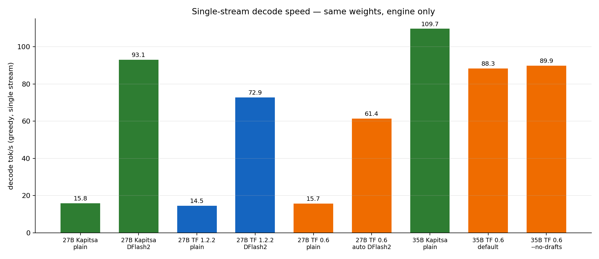
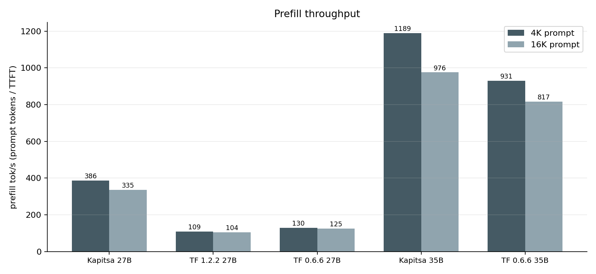
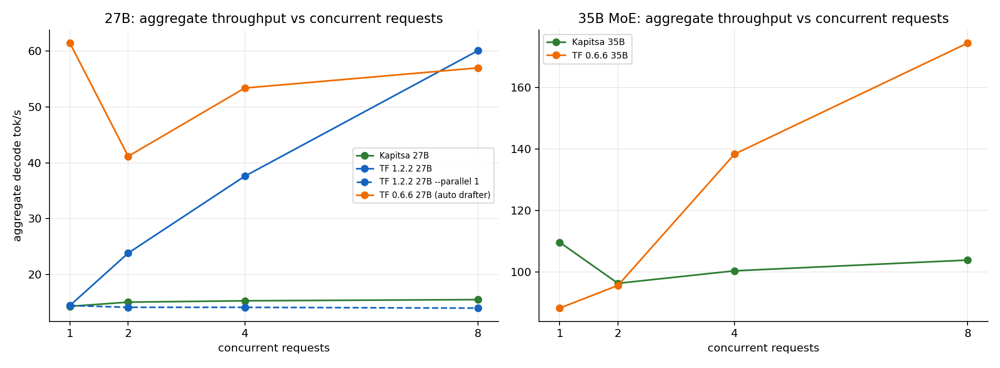
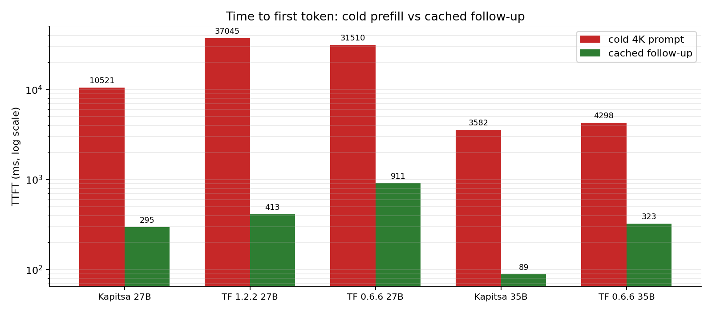

# TensorFold vs Kapitsa — 同一台 Mac、同一份权重上的深度评测

> 评测对象：**Kapitsa 0.2.26**、**TensorFold 1.2.2（原生 Zig 引擎）**、**TensorFold 0.6.6（旧版 Python + MLX 引擎）**
> 硬件：Mac mini M4 Pro（14 CPU / 20 GPU / 64 GB），macOS 27.2
> 主模型：`TensorFold/Qwen3.8-27B-MLX-4bit`（14.98 GiB，64 层 dense，带视觉塔）
> 次模型：`mlx-community/Qwen3.5-35B-A3B-4bit`（19.5 GB，40 层 MoE，本机原有）
> 全部原始数据、脚本、日志都在本仓库，可逐条复现。

---

## 0. 结论先行（TL;DR）

1. **TensorFold 不是"一个引擎"，而是两代引擎。** 当前发布的 1.2.2 原生引擎**根本无法加载**用户本机原有的 Qwen3.5-35B-A3B（`model_type=qwen3_5_moe`），只有旧版 0.6.6（Python + MLX）能跑。这是本次评测最重要的可用性事实。
2. **在两者都支持的 Qwen3.8-27B 上，Kapitsa 单流更快、首 token 更快、prefill 快 3.0–3.5 倍、内存低 6 GiB；TensorFold 的并发批处理强 3.9 倍。**
   - 单流 decode（plain）：Kapitsa 15.8 tok/s ≈ TF 1.2.2 14.5 ≈ TF 0.6.6 15.5
   - 加同一个 DFlash2 drafter：**Kapitsa 93.1** > TF 1.2.2 72.9 > TF 0.6.6 61.4 tok/s
   - Prefill 4K：**Kapitsa 386** > TF 0.6.6 130 > TF 1.2.2 109 tok/s
   - 缓存后 TTFT：**Kapitsa 295 ms** < TF 1.2.2 413 ms < TF 0.6.6 911 ms
   - 8 并发聚合：**TF 1.2.2 60.0** > TF 0.6.6 57.0 > Kapitsa 15.5 tok/s
3. **35B MoE 上只有 Kapitsa 是完整可用的选择**：Kapitsa 109.7 tok/s，TF 0.6.6 88.3 tok/s；8 并发时 TF 0.6.6 反超到 174 tok/s（Kapitsa 103.9），但 TF 1.2.2 完全不能跑。
4. **推测解码是最大的性能杠杆，远大于引擎差异**：同一份 DFlash2 drafter 让 27B 从 ~15 tok/s 提升到 73–93 tok/s（5–6 倍）。Kapitsa 的 KFlash 树验证比 TF 1.2.2 再快 28%。但**用户本机的 35B checkpoint 没有 MTP/DFlash 旁文件，两个引擎都只能 plain decode**。
5. **功能面各有缺口**：Kapitsa 默认支持图像、JSON Schema、Anthropic/Responses API、API key，但没有 `/metrics`、`/v1/completions`，也不做跨请求批处理；TensorFold 有完整 `/metrics`、`/v1/completions`、批处理、上下文压缩等，但 0.6.6 不支持 `response_format`，1.2.2 的视觉需要 `--vision` 且 0.6.6 的视觉因缺 torchvision 直接起不来。
6. **同一模型、贪心解码，不同引擎的输出并不保证逐 token 相同**：27B 上 Kapitsa 与 TF 1.2.2 六条 prompt 全部一致；TF 0.6.6 有 1/6 条在约 40 token 后分叉。35B 上 Kapitsa 与 TF 0.6.6 六条全一致。跨引擎"位级一致"不能当作默认假设。
7. **质量由模型决定，不由引擎决定**：12 项任务，27B 三个引擎都是 10/12（同错两题），35B 两个引擎都是 11/12。
8. **选型建议**：
   - 日常交互/编码、27B 或 35B、要低延迟 → **Kapitsa**（配 DFlash2）。
   - 要跑 8 路以上并发、要 Prometheus 指标、要完整 OpenAI 兼容面 → **TensorFold 1.2.2**（前提是模型在其支持列表内）。
   - 必须跑 Qwen3.5-35B-A3B → **Kapitsa**；TensorFold 只能退回 0.6.6。
   - 需要图像输入 → Kapitsa 开箱即用；TensorFold 1.2.2 需 `--vision`；0.6.6 在本机不可用。

---

## 1. 评测对象

| | Kapitsa | TensorFold 1.2.2 | TensorFold 0.6.6 |
|---|---|---|---|
| 版本 | 0.2.26 (`6ef19b0`) | `tensorfold-native 1.2.2` | `tensorfold 0.6.6` |
| 安装 | `brew install nace-ai/tap/kapitsa` | `brew install ashhart/tensorfold/tensorfold` | `brew install ashhart/tensorfold/tensorfold@0.6` |
| 运行时 | 原生 Metal（无 Python） | 原生 Zig + Metal | Python + MLX |
| License | Apache-2.0 | Apache-2.0 | Apache-2.0 |
| 定位 | Apple silicon 上的 Qwen 专用服务 | Apple silicon / NVIDIA 通用原生引擎 | 上一代 Python 引擎，模型覆盖更广 |

### 1.1 模型

| 模型 | 架构 | 权重大小 | 用途 |
|---|---|---|---|
| `TensorFold/Qwen3.8-27B-MLX-4bit` | dense 64 层，hidden 5120，4-bit g64，带 ViT | 14.98 GiB | **主对比模型**（两个引擎都原生支持） |
| `mlx-community/Qwen3.5-35B-A3B-4bit` | MoE 40 层，256 experts / 8 active，hidden 2048 | 19.5 GB | 用户原有模型，验证"本机模型"路线 |
| `qwen3.5-4b-4bit`（Kapitsa 自带） | dense 4B + MTP head + DFlash2 | 4.57 GB | 推测解码消融（DFlash2 vs MTP vs plain） |

> 为什么有两条主线：用户最初要求用本机 35B。实测发现 **TensorFold 1.2.2 拒绝 `qwen3_5_moe`**（报错明确建议退回 0.6），而 0.6.6 能跑但功能旧。随后用户指定 `Qwen3.8-27B-MLX-4bit`，它同时被 1.2.2、0.6.6、Kapitsa 支持，因此成为唯一能做"同权重、同机器、三引擎"对比的模型。35B 作为第二条线保留，用于回答"我本机这个模型到底能不能跑"。

---

## 2. 评测方法

### 2.1 公平性规则

- **一次只跑一个引擎**，全部 GPU 任务共享 `/tmp/tensorfold-vs-kapitsa-gpu.lock`（`flock`），避免相互抢 GPU。
- 每个引擎启动后先 warmup，再测量；同一配置内取 5 次中位数（探针取 3 次）。
- **显式采样**：贪心用 `temperature=0`；采样用 `temperature=0.6, top_p=0.95, top_k=20`（Qwen 推荐值）。
- **统一关闭 thinking**：请求同时带 `chat_template_kwargs.enable_thinking=false` 与 `reasoning_effort="none"`；服务端能关的也关。thinking 单独做消融。
- **冷 prompt 带 nonce**：4K/16K 预填在 system 起始后插入随机 nonce，防止任何前缀缓存命中。
- **decode 速率按真实 token 数算**：SSE 事件数 ≠ token 数（Kapitsa 会把多个字符合进一个事件），因此用服务端 `usage.completion_tokens` 除以首/末 token 事件时间差；TTFT 从请求发出到第一个内容/推理 token。
- **缓存测量**：先发 4K 冷 prompt，再追加三轮 follow-up，取中位 TTFT，并记录 `cached_tokens`。
- **并发测量**：2/4/8 路同时发 256-token 请求，记录总墙钟、聚合 tok/s、每流 tok/s、TTFT 中位数。

### 2.2 测量阶段

| 阶段 | 内容 |
|---|---|
| startup | 启动到 `/health` 就绪、`footprint` 内存、`/v1/models` 元数据 |
| decode | 512-token 编码题，贪心 5 次 + 采样 5 次 |
| prefill | 4K / 16K 冷 prompt，TTFT 与 prompt tok/s |
| cached | 4K 冷启动 + 3 轮追加，TTFT 与 cached_tokens |
| concurrency | 2 / 4 / 8 路并发 256-token |
| longctx | 22.5K token 文档中置入 passphrase，检索正确性 + TTFT |
| tools | 非流式工具调用、工具结果回填、流式工具调用 |
| structured | `response_format=json_schema` 与 `json_object`，校验 JSON |
| thinking | 同一数学题 thinking 开/关的 token 数与耗时 |
| errors | 空 messages、未知模型、缺 messages、超大 max_tokens、非法 role、坏 JSON |
| cancel | 流式请求中途断开，检查服务健康与后续请求 |
| endpoints | `/v1/models`、`/health`、`/metrics`、`/v1/completions`、`/v1/responses`、`/v1/messages`、`/v1/embeddings`、图像输入 |
| quality | 12 项可自动判分的任务（算术、单位、代码执行、JSON、指令遵循、检索、翻译、逻辑、日期等） |
| fidelity | 6 条固定 prompt 贪心 96 token，记录输出 SHA-256，用于跨引擎比对 |
| sustain | 35B 上连续 75 秒 decode，比较首/末三分之一，记录热状态 |

### 2.3 本机限制（必须一起读）

- **单机单次**：每个配置只跑一轮，没有跨天重复；M4 Pro 的 GPU 频率/后台进程会带来几个百分点的波动。
- **加载时间受 page cache 影响**：Kapitsa 用 mmap，热缓存下 2–4 秒；TensorFold 0.6.6 是 eager load，27B 要 133 秒。冷启动未测（清 page cache 需要 root）。
- **没有功耗墙**：`powermetrics` 需要 root，未采；只记录了 `pmset -g therm`（全程 nominal）与 75 秒热衰减。
- **并发只到 8**；上下文只测到 22.5K；没有第二台 Mac，无法测 cluster/TP。
- **TensorFold 0.6.6 会自动发现 HF cache 里的 drafter**（本次是 z-lab DFlash2），这会让"默认配置"随缓存内容变化；报告里同时给了 `--no-drafts` 的对照。
- 质量集是 12 项自建任务，不是 MMLU/GSM8K 这类标准 benchmark；它用来验证"引擎是否改变了模型行为"，不用于给模型打分。
- 跨引擎逐 token 一致性只查了 6 条 prompt。

---

## 3. 性能结果

### 3.1 单流 decode



| 配置 | decode tok/s（贪心） | decode tok/s（采样） | TTFT |
|---|---:|---:|---:|
| 27B · Kapitsa plain | 14.3 | 15.8 | 367 ms |
| 27B · Kapitsa + DFlash2 | **93.1** | — | 102 ms |
| 27B · TF 1.2.2 plain | 14.5 | 14.6 | 442 ms |
| 27B · TF 1.2.2 + DFlash2 | 72.9 | — | 320 ms |
| 27B · TF 0.6.6 plain（`--no-drafts`） | 15.5 | — | 270 ms |
| 27B · TF 0.6.6 默认（自动 DFlash2） | 61.4 | 59.0 | 509 ms |
| 35B · Kapitsa plain | **109.7** | 107.5 | 64 ms |
| 35B · TF 0.6.6 默认（prompt-lookup） | 88.3 | 87.4 | 102 ms |
| 35B · TF 0.6.6 `--no-drafts` | 89.9 | — | 105 ms |
| 4B · Kapitsa plain | 88.9 | — | — |
| 4B · Kapitsa MTP depth 4 | 225.4 | — | — |
| 4B · Kapitsa DFlash2 | **404.6** | — | — |

要点：

- 没有 drafter 时，27B dense 在三个引擎上都只有 ~15 tok/s，差异在噪声内。**引擎差异远小于"有没有 drafter"**。
- 同一份 z-lab DFlash2 下，Kapitsa 的 KFlash（DFlash2 lattice + tree verify）比 TF 1.2.2 快 **28%**（93.1 vs 72.9）。
- TF 0.6.6 的自动 drafter 只带来 4.0×（15.5 → 61.4），低于另外两家，Python/MLX 调度开销明显。
- 35B MoE 的 active 参数只有 3B，所以 plain decode 就有 ~110 tok/s；TF 0.6.6 的自带 prompt-lookup drafting 在这里**没有收益**（88.3 vs 关闭后 89.9，甚至略负）。
- 4B 上 KFlash 的层次很清楚：plain 88.9 → MTP 225.4（2.5×）→ DFlash2 404.6（4.6×）。
- 口径说明：带 drafter 的行来自与 plain **配对**的 probe（256 token、3 次中位数）；baseline 的 5×512 次测量得到 plain 14.3。因此消融 A1/A2/A3 的倍率用配对 probe 的 15.8/14.5/15.5 作分母，而不是表里的 14.3。

### 3.2 Prefill（读 prompt）



| 配置 | 4K prompt tok/s | 16K prompt tok/s | 4K TTFT | 16K TTFT |
|---|---:|---:|---:|---:|
| 27B · Kapitsa | **386** | **335** | 10.6 s | 48.8 s |
| 27B · TF 1.2.2 | 109 | 104 | 37.6 s | 157.1 s |
| 27B · TF 0.6.6 | 130 | 125 | 31.5 s | 130.6 s |
| 35B · Kapitsa | **1189** | **976** | 3.4 s | 16.8 s |
| 35B · TF 0.6.6 | 931 | 817 | 4.4 s | 20.0 s |
| 4B · Kapitsa（DFlash2/plain） | ~2035 | — | 2.0 s | — |

要点：

- **Kapitsa 的 prefill 是本次最大的单项优势**：27B 上比 TF 1.2.2 快 3.5×，比 TF 0.6.6 快 3.0×；35B 上比 TF 0.6.6 快 1.28×。
- TF 1.2.2 在 M4 Pro 上把 27B 的 prompt 切成 **128 token 一段**（启动日志："prompt chunks of up to 128 tokens"），而 35B 的 TF 0.6.6 是 2048 一段。这不是配置问题：`TF_PROMPT_ROWS=2048` 只改了行容量，chunk 仍是 128，prefill 仍是 107.7 tok/s。TF 官方 27B 数据是在 M5 Ultra 上测的（1325 tok/s），**M4 这代没有对应的原生优化**。
- Kapitsa 的 prefill 默认 2048 一段，并调用 Neural Engine 分担 FFN；改成 512 或 4096 都会显著变慢（见消融 A8）。
- 长上下文（22.5K）TTFT：Kapitsa 27B 71.7 s / TF 1.2.2 224.9 s / TF 0.6.6 183.8 s；35B 上 25.8 s / 27.7 s。三个引擎都正确检索到 passphrase。

### 3.3 并发与批处理



| 配置 | n=1 | n=2 | n=4 | n=8 | n=8 的 TTFT 中位数 |
|---|---:|---:|---:|---:|---:|
| 27B · Kapitsa（slots=4） | 14.3 | 15.1 | 15.3 | **15.5** | 11.9 s |
| 27B · TF 1.2.2（parallel auto=8） | 14.5 | 23.9 | 37.6 | **60.0** | 1.41 s |
| 27B · TF 1.2.2 `--parallel 1` | 14.5 | 14.2 | 14.2 | **14.0** | 23.4 s |
| 27B · TF 0.6.6（auto drafter） | 61.4 | 41.2 | 53.4 | 57.0 | 1.49 s |
| 35B · Kapitsa（slots=4） | 109.7 | 96.4 | 100.4 | **103.9** | 1.52 s |
| 35B · TF 0.6.6 | 88.3 | 95.7 | 138.3 | **174.4** | 0.43 s |

要点：

- **Kapitsa 不做跨请求 decode 批处理。** 每个请求日志都写着 `0 cycles batched with other requests`；slots 只是让多个对话保持热态，GPU 轮流服务。因此 8 并发时聚合吞吐仍是 ~15 tok/s（27B），每流被压到 ~4 tok/s，而排队导致 TTFT 中位数 11.9 s。
- **TF 1.2.2 的共享 lane 是真批处理**：8 并发聚合 60 tok/s（4.1×），单流只降到 ~8.5 tok/s。`--parallel 1` 时聚合回落到 14 tok/s，直接证明增益来自 batching 而不是缓存。
- TF 0.6.6 也批处理（35B 上 8 并发 174 tok/s，1.97×），但 27B 上受 drafter 竞争影响，n=2 反而低于单流。
- 结论：**要吞吐选 TF，要单请求延迟选 Kapitsa**。两者不是同一优化目标。

### 3.4 前缀缓存



| 配置 | 4K 冷 TTFT | 缓存后 follow-up TTFT | 提升 |
|---|---:|---:|---:|
| 27B · Kapitsa | 10.5 s | **295 ms** | 35× |
| 27B · TF 1.2.2 | 37.0 s | 413 ms | 90× |
| 27B · TF 0.6.6 | 31.5 s | 911 ms | 35× |
| 35B · Kapitsa | 3.58 s | **88.6 ms** | 40× |
| 35B · TF 0.6.6 | 4.30 s | 323 ms | 13× |

- Kapitsa 的 follow-up 最快（35B 上 89 ms），并且把会话写进 SSD（`~/.cache/kapitsa/prefix-cache`），重启后还能恢复。
- TF 1.2.2 即使 `--prompt-cache-gib 0`，follow-up 仍是 ~480 ms，因为 27B 的 slot-resume 会复用上一条回复留下的状态；它的 prompt cache 主要影响"新问题复用同一前缀"。
- TF 0.6.6 的缓存命中报告 `cached_tokens=4086`，但 TTFT 仍是 911 ms，说明它的缓存路径还有额外开销。

### 3.5 启动、内存、持续性能

| 配置 | 启动到就绪 | 空闲 footprint | 峰值 footprint | 75 s 热衰减 |
|---|---:|---:|---:|---:|
| 27B · Kapitsa | **1.8 s**（热缓存） | **15 GiB** | 22 GiB | — |
| 27B · TF 1.2.2 | 2.9 s | 21 GiB | **41 GiB** | — |
| 27B · TF 0.6.6 | 133 s | 18 GiB | 31 GiB | — |
| 35B · Kapitsa | 4.1 s | **18 GiB** | 22 GiB | 109.9 → 107.6 tok/s（−2.1%） |
| 35B · TF 0.6.6 | 22.9 s | 20 GiB | 29 GiB | 89.6 → 89.1 tok/s（−0.6%） |

- TF 1.2.2 为 8 条 lane 预留 KV/状态，27B 峰值到 41 GiB；在 64 GB 机器上同时开浏览器/IDE 时要留意。
- TF 0.6.6 的 27B 加载 133 秒（首次还要编译 kernel），不适合频繁重启的开发循环。
- 75 秒持续负载下两者都没有热降频（`pmset -g therm` 全程 nominal），Kapitsa 衰减 2.1%，TF 0.6.6 0.6%。

### 3.6 质量与保真度

12 项任务（贪心，thinking off）：

| 引擎 | 27B | 35B |
|---|---:|---:|
| Kapitsa | 10/12 | 11/12 |
| TF 1.2.2 | 10/12 | 不支持 |
| TF 0.6.6 | 10/12 | 11/12 |

27B 上三个引擎错的是同样两题（`137*29+46` 算成 4219；2030-01-01 说成 Wednesday）。这不是引擎差异，是模型能力差异。

逐 token 保真度（6 条固定 prompt，贪心 96 token，输出 SHA-256）：

| 对比 | 一致的 prompt 数 | 合并 SHA |
|---|---:|---|
| 27B Kapitsa vs TF 1.2.2 | **6/6** | `7e79897e0f4ecf4726ed37f1` |
| 27B Kapitsa vs TF 0.6.6 | 5/6 | TF 0.6.6 为 `f1dcdb9e083b8a80c8222f60` |
| 35B Kapitsa vs TF 0.6.6 | **6/6** | `5633e6ae9f1f0c49d6c3f9ff` |

> 27B 第 4 条（解释 hash table）在约 40 token 后分叉：TF 1.2.2 写 "constant-time lookups, insert…"，TF 0.6.6 写 "constant-time operations for…"。同一份权重、同样的贪心参数，不同 kernel 的浮点归约顺序不同，接近平局的位置就会翻转。**"同模型 = 同输出"不成立**；如果业务依赖可复现输出，需要固定引擎版本 + 记录 token hash。

### 3.7 用户本机的 35B 模型（原始目标）

| | Kapitsa 0.2.26 | TensorFold 1.2.2 | TensorFold 0.6.6 |
|---|---|---|---|
| 能否加载 `qwen3_5_moe` | ✅ | ❌ 明确拒绝 | ✅ |
| decode | 109.7 tok/s | — | 88.3 tok/s |
| prefill 4K / 16K | 1189 / 976 | — | 931 / 817 |
| 8 并发聚合 | 103.9 | — | **174.4** |
| 缓存 TTFT | **88.6 ms** | — | 323 ms |
| 质量（12 题） | 11/12 | — | 11/12 |
| 结构化输出 | ✅ | — | ❌ |
| 图像 | ✅ | — | ❌（本机缺 torchvision） |
| 内存峰值 | **22 GiB** | — | 29 GiB |

**这是本次最实用的结论：如果你就是要跑本机这份 Qwen3.5-35B-A3B-4bit，TensorFold 当前版本不是一个可用选项（1.2.2 不支持，0.6.6 能跑但缺功能且更慢），Kapitsa 是唯一完整可用的引擎。**

---

## 4. 消融实验（每项单独控制变量）

| # | 引擎 | 变量 | 配置 A | 配置 B | 结果 | 结论 |
|---|---|---|---|---|---|---|
| A1 | Kapitsa 27B | DFlash2 开/关 | plain 15.8 tok/s | DFlash2 **93.1** | **5.9×** | drafter 是最大杠杆；KFlash 树验证接受率 7.15 tok/cycle |
| A2 | TF 1.2.2 27B | drafter 开/关 | plain 14.5 | DFlash2 **72.9** | **5.0×** | 同一份 z-lab drafter，TF 比 Kapitsa 慢 28% |
| A3 | TF 0.6.6 27B | drafter 开/关 | `--no-drafts` 15.5 | 自动 DFlash2 **61.4** | **4.0×** | 自动发现 drafter 有效，但 Python 开销更大 |
| A4 | Kapitsa 4B | 推测解码方式 | plain 88.9 | MTP 225.4 / DFlash2 **404.6** | 2.5× / **4.6×** | MTP 与 DFlash2 差距明显 |
| A5 | TF 1.2.2 27B | `TF_PROMPT_ROWS` | 512 → 108.9 tok/s | 2048 → 107.7 | **无变化** | chunk 仍被限制在 128 token，行容量不是瓶颈 |
| A6 | TF 1.2.2 27B | `--parallel` | 1 → 14.2 tok/s @8 | auto=8 → **60.0** | **4.2×** | 吞吐完全来自跨请求 batching |
| A7 | TF 1.2.2 27B | prompt cache 关 | 默认 413 ms | `--prompt-cache-gib 0` 480 ms | +16% | slot-resume 仍在工作；缓存不是 follow-up 的唯一来源 |
| A8 | Kapitsa 27B | prefill chunk | 512 → 192 / 2048 → **386** / 4096 → 136 tok/s | — | 默认最优 | 4096 会禁用 Neural Engine 分担（日志明确说明），慢 2.8×；512 则 chunk 开销过大 |
| A9 | Kapitsa 27B | thinking 开/关 | off 6 token / 0.86 s | on 116 token / 8.0 s | **19× token，9× 时间** | 默认 thinking 会悄悄烧掉大量 token |
| A10 | TF 0.6.6 35B | drafts 开/关 | `--no-drafts` 89.9 | 默认 88.3 | **−1.8%** | prompt-lookup 在 35B MoE 上无收益 |
| A11 | 两代 TF | 引擎代际 | 0.6.6：61.4 tok/s，load 133 s，无 JSON schema | 1.2.2：72.9（+drafter），load 2.9 s，有 JSON schema | 1.2.2 全面更强 | 但 1.2.2 不支持 35B MoE |
| A12 | 三引擎 | thinking 默认值 | 全部默认开 | 请求级关闭成功 | 6 vs 116 token | 所有引擎都支持 `enable_thinking=false` + `reasoning_effort=none` |
| A13 | Kapitsa / TF 1.2.2 27B | context 8K vs 32K | K：16.09 tok/s、406.7 prefill、17 GiB | K：15.85、386、19 GiB | <5% 速度差，+2 GiB | 短 prompt 下上下文窗口几乎不影响速度，代价主要是内存；TF 1.2.2 同样（14.69/107 vs 14.5/109） |

> 未做：8-bit/bf16 量化对比、KV cache dtype（TF 1.2.2 的 `--kv-cache` 在 27B Metal 路径未验证）、32K 以上上下文、多机 TP/cluster。

---

## 5. 功能逐项对比

图例：✅ 实测通过 · ⚠️ 需额外开关/有条件 · ❌ 不支持/未通过 · — 未测
> 未特别标注的 ✅ 均有本次实测；标"文档"的依据官方 README / `--help`，本次未单独验证。

| # | 能力 | Kapitsa 0.2.26 | TF 1.2.2 | TF 0.6.6 | 证据/说明 |
|---|---|---|---|---|---|
| 1 | OpenAI Chat Completions | ✅ | ✅ | ✅ | 流式/非流式均通过 |
| 2 | OpenAI `/v1/completions` | ❌ 404 | ✅ | ✅ | Kapitsa 只做 chat/responses/messages |
| 3 | OpenAI Responses API | ✅ | ✅ | ✅ | `status=completed/incomplete` 均正常 |
| 4 | Anthropic Messages API | ✅ | ✅ | ✅ | `/v1/messages` 返回标准 content block |
| 5 | `/v1/messages/count_tokens` | ⚠️ 文档列出，未单测 | — | — | 未单独测 |
| 6 | 流式 SSE + usage | ✅ | ✅ | ✅ | 三家都在最后 chunk 带 usage |
| 7 | 工具调用（非流式） | ✅ | ✅ | ✅ | 都正确产出 `get_weather` |
| 8 | 工具调用（流式增量） | ✅ | ✅ | ✅ | TF 1.2.2 分 5 个 delta，Kapitsa 1 个 |
| 9 | 工具结果回填 | ✅ | ✅ | ✅ | 都回答 "18°C" |
| 10 | JSON Schema 结构化输出 | ✅ | ✅ | ❌ 400 | 0.6.6 不支持 `response_format` |
| 11 | `json_object` 模式 | ✅ | ✅ | ❌ 400 | 同上 |
| 12 | thinking 开关 | ✅ | ✅ | ✅ | 请求级 `enable_thinking` / `reasoning_effort` |
| 13 | reasoning effort 档位 | ✅（`low/medium/high`） | ✅（`low/medium/high/xhigh`，`/v1/models` 会广告） | ✅ | TF 1.2.2 元数据更完整 |
| 14 | thinking budget | — | ✅ `--thinking-budget` | ✅ | 未测 |
| 15 | 图像输入 | ✅ 默认开 | ⚠️ 需 `--vision` | ❌ 本机缺 torchvision | Kapitsa 1×1 红图答 "Red"；TF 1.2.2 答 "pink"；0.6.6 启动即报缺 torchvision |
| 16 | 前缀缓存（内存） | ✅ | ✅ | ✅ | cached_tokens 均正确 |
| 17 | 前缀缓存（SSD/跨重启） | ✅ `--disk-cache` | ⚠️ `--learn`（27B 拒绝） | — | Kapitsa 默认 32 GiB SSD cache |
| 18 | 推测解码 | ✅ KFlash：DFlash2 / MTP | ✅ DFlash2（需 `--drafter`） | ✅ 自动发现 + prompt lookup | 见消融 A1–A4、A10 |
| 19 | 跨请求批处理 | ❌（0 cycles batched） | ✅ 最多 8 路 | ✅ 最多 8 路 | 见 §3.3 |
| 20 | 模型发现元数据 | ✅ 目录 + context_length + slots + variants | ✅ context_length + max_model_len + reasoning | ⚠️ 仅 id | `/v1/models` 实测 |
| 21 | Prometheus `/metrics` | ❌ 404 | ✅ 16.9 KB | ✅ 8.1 KB | TF 有 running/waiting/tokens/KV/MTP/latency |
| 22 | `/dashboard`、`/stats`、`/v1/load` | ❌ | ✅（文档） | ⚠️ | 1.2.2 专属 |
| 23 | API key 鉴权 | ✅ 401/200 | ✅ 401/200 | ⚠️ 有开关，未测 | 实测 Kapitsa/TF 1.2.2 |
| 24 | 错误语义 | ⚠️ 空 messages 返回 Jinja 堆栈；未知模型被忽略（200）；超大 max_tokens 被接受 | ✅ 清晰的 400 + 上下文说明 | ✅ 清晰 400 | TF 的错误信息更适合生产 |
| 25 | 请求取消 | ✅ | ✅ | ✅ | 断开后健康、后续请求正常 |
| 26 | 上下文窗口 | 模型上限（Qwen 128K） | 默认 32K，最高 262144 | 262144 | 本次只压到 22.5K |
| 27 | 上下文压缩 | ❌ | ✅（文档）`--compact-at` | ❌ | 未测 |
| 28 | 多机/分布式 | ✅ cluster / split / stage | ✅ 双 Mac TP / Starlight | ⚠️ | 本机单台未测 |
| 29 | 模型管理 CLI | ✅ pull/list/rm/import GGUF/doctor/bench | ✅ pull/models/info + Mac app | ✅ 同左 | Kapitsa 还能把 GGUF 转成模型 |
| 30 | 代理/编码工具集成 | ✅ `claude`/`codex`/`opencode`/`pi` 一条命令 | ✅ Mac app / coding workers / ATC | ✅ | 未实测代理会话 |
| 31 | 语音 / 音频 | ❌ | ✅ `/v1/audio/speech` | ⚠️ | 未测；需 Drama 权重 |
| 32 | 运行时依赖 | 无 Python | 无 Python | Python + MLX（视觉还要 torchvision） | 0.6.6 的部署面明显更重 |
| 33 | 平台 | macOS Apple silicon | macOS + NVIDIA CUDA | macOS + CUDA | 本机只有 Metal |
| 34 | 安装方式 | brew | brew / release tarball | brew（keg-only） | 都是 Apache-2.0 |

### 5.1 分项裁决

| 维度 | 胜者 | 理由 |
|---|---|---|
| 单流延迟（无 drafter） | 平手 | 27B 都是 ~15 tok/s |
| 单流延迟（有 drafter） | **Kapitsa** | 93.1 vs 72.9 vs 61.4 |
| Prefill / 长 prompt | **Kapitsa** | 3–3.5× |
| 缓存后 TTFT | **Kapitsa** | 89–295 ms |
| 并发吞吐 | **TensorFold** | 8 路 60 vs 15.5（27B）；174 vs 104（35B） |
| 内存 | **Kapitsa** | 15 vs 21/18 GiB idle |
| 启动速度 | **Kapitsa ≈ TF 1.2.2** | 2–4 s vs 133 s（0.6.6） |
| API 覆盖 | **TensorFold 1.2.2** | completions/responses/messages/metrics/dashboard |
| 开箱模态能力 | **Kapitsa** | 图像/JSON Schema 默认可用 |
| 模型覆盖（本机） | **Kapitsa** | 35B MoE 只有它能完整跑 |
| 错误/运维友好度 | **TensorFold** | 清晰 400 + metrics |
| 部署轻量 | **Kapitsa ≈ TF 1.2.2** | 原生二进制；0.6.6 需 Python |

---

## 6. 整合评测过程（时间线 + 踩坑）

| 时间 | 事件 |
|---|---|
| 10:35 | 确认工作区为空 git 仓库；定位本机 Kapitsa 0.2.26（brew）与 HF 缓存里的 Qwen3.5-35B-A3B-4bit（19 GB） |
| 10:37 | 安装 TensorFold 1.2.2（brew）；确认其为原生 Zig 引擎 |
| 10:38 | `tensorfold info` 报错：`qwen3_5_moe` 无原生 family，建议退回 0.6 线 → 安装 0.6.6 |
| 10:39 | 确认 0.6.6 能识别 35B（`family Qwen3.6 MoE`），但 1.2.2 不能 |
| 10:40 | 用户指定改用 `Qwen3.8-27B-MLX-4bit`；开始 16 GB 下载（43 MB/s，约 6 分钟） |
| 10:41 | 确认该 checkpoint 同时被 1.2.2 / 0.6.6 / Kapitsa 支持 → 定为三引擎主模型 |
| 10:42 | 手写 benchmark harness；用 35B 做 smoke（Kapitsa 76.8 tok/s、TF 0.6.6 78.5 tok/s） |
| 10:50 | 发现 smoke 的 Kapitsa 数字偏低（后台下载 I/O 干扰），改为正式 run 的 5 次中位数 |
| 10:52 | 修复 decode 速率算法：SSE 事件 ≠ token，改用 `usage.completion_tokens` |
| 10:57 | 下载 z-lab DFlash2 drafter（3.85 GB），用于 27B 推测解码消融 |
| 11:00–11:15 | 27B 三引擎 baseline（Kapitsa / TF 1.2.2 / TF 0.6.6） |
| 11:14 | 修复 `post_chat` 返回 tuple 导致 tools/structured 阶段崩溃，补跑 features |
| 11:20–11:35 | 35B 两引擎 baseline + 持续负载 |
| 11:36–11:45 | 消融：drafter、prompt rows、parallel、prompt cache、prefill chunk、4B KFlash |
| 11:45–11:52 | 视觉/鉴权/错误语义等补充探测；生成图表与汇总 |

踩过的坑（也是方法的一部分）：

1. **TensorFold 1.2.2 不支持用户最初的 35B MoE** —— README 的模型表只在 CUDA 段提到 Qwen3.6-35B-A3B，Metal 段没有；必须实际 `info` 才发现。
2. **TensorFold 0.6.6 不能跑 4B** —— `tied embedding head is not supported by this packed Qwen decoder`，所以 4B 的 KFlash 消融只能做 Kapitsa 单边。
3. **TF 0.6.6 的视觉需要 torchvision**，本机 Python 环境没有；这不是开关问题，是依赖缺失。
4. **Kapitsa 的 35B 没有 drafter 旁文件**（checkpoint 只有 `model.safetensors`），所以 35B 只能 plain decode；27B 的 DFlash2 是外挂 z-lab drafter。
5. **TF 1.2.2 的 27B prefill 在 M4 上被 128-token chunk 卡住**，`TF_PROMPT_ROWS=2048` 无效；这是硬件代际问题，不是配置问题。
6. **TF 0.6.6 会自动扫描 HF cache 找 drafter**，导致"默认配置"依赖缓存内容；正式对比必须显式 `--no-drafts` / `--drafter`。
7. **SSE 事件数不等于 token 数**，早期版本会把 Kapitsa 的 decode 速率高估 ~30%。

---

## 7. Lessons & Learn

1. **先问"支持我的 checkpoint 吗"，再问"谁更快"。** TensorFold 1.2.2 在支持的模型上很优秀，但它把 `qwen3_5_moe` 留给了旧引擎；用户本机的 35B 恰好落在缺口里。模型矩阵比跑分更决定选型。
2. **Checkpoint 的旁文件决定性能上限。** 没有 MTP/DFlash 文件时，两个引擎都只能 ~15 tok/s（27B dense）；补上 drafter 立刻 5–6×。买模型/下载模型时要看 `mtp.safetensors`、`dflash2/` 是否齐全。
3. **"同模型同输出"是错觉。** 27B 上 TF 0.6.6 与另外两家在 1/6 条 prompt 上分叉；贪心只是"同一实现内确定"，不是"跨实现确定"。需要可复现性时固定引擎 + 版本 + 记录 token hash。
4. **默认参数是调过的，别乱改。** Kapitsa 的 prefill chunk 2048 正好让 Neural Engine 参与；改成 4096 直接禁用 ANE，prefill 从 386 掉到 136 tok/s（2.8×）。
5. **"新版本"不等于"更全"。** TF 1.2.2 比 0.6.6 加载快 46×、带 drafter 的 decode 快 19%、有 JSON schema 与完善 metrics，但 prefill 反而慢 16%（109 vs 130 tok/s），模型覆盖也更窄；0.6.6 是"能跑更多模型"的兜底。
6. **延迟与吞吐是两种产品。** Kapitsa 把单请求做到极致（93 tok/s、89 ms 缓存 TTFT），TF 把并发做到 4×；用聊天体验的标准去评测批处理引擎，或反过来，都会得出错误结论。
7. **自动发现是双刃剑。** TF 0.6.6 自动加载了 HF cache 里的 drafter，让"默认"行为随环境变化；生产环境应显式指定 `--drafter` / `--no-drafts`。
8. **看 TTFT，不要只看聚合 tok/s。** Kapitsa 27B 在 8 并发时聚合 15.5 tok/s 看似正常，但 TTFT 中位数 11.9 秒；TF 1.2.2 聚合 60 tok/s、TTFT 1.4 秒。聚合数字会掩盖排队。
9. **长上下文很贵，缓存是刚需。** 22.5K prompt 在 27B 上冷启动 72–225 秒；缓存后 follow-up 只要 0.3–0.9 秒。没有前缀缓存的引擎在 agent 场景不可用。
10. **评测脚本本身会骗人。** SSE chunk 计数、thinking 默认值、page cache、后台下载、自动 drafter——每一个都能让数字偏移 20% 以上。这次每一处都做了对照才敢下结论。

---

## 8. Take away

- **这台 M4 Pro / 64 GB 上，我的默认选择是 Kapitsa + Qwen3.8-27B + DFlash2**：93 tok/s、缓存后 0.3 秒首 token、15 GiB 内存、一条命令接 Claude Code/Codex。它是最接近"本地 API"体验的组合。
- **TensorFold 1.2.2 我会留给"批量/多人/可观测"场景**：8 路并发 60 tok/s、Prometheus、完整 OpenAI 兼容面、清晰的错误。但它必须先确认模型在支持列表里，而且 27B 在 M4 上的 prefill 只有 109 tok/s，长 prompt 要等。
- **35B MoE 没有悬念**：TensorFold 1.2.2 不能跑，0.6.6 能跑但慢且缺结构化输出；Kapitsa 是唯一完整答案。
- **推测解码的优先级高于引擎选型**：同一份 drafter 带来的 5–6× 远大于引擎之间的 28%。如果只能做一件事，先把 drafter 配齐。
- **不要迷信"同权重可复现"**：跨引擎会有 token 级分叉；把引擎版本、量化、drafter、thinking 开关一起写进实验记录。
- 如果让我给两个项目各提一个建议：
  - Kapitsa：把跨请求 batching 做起来（现在 8 并发聚合被 TF 反超 3.9×），并补 `/metrics` 与 `/v1/completions`。
  - TensorFold：把 1.2.2 的 Metal 模型覆盖补到 `qwen3_5_moe`，或在启动时给出比"退回 0.6"更明确的迁移路径；同时把 27B 在 M4 上的 128-token chunk 限制写进文档。

---

## 9. 复现

```bash
# 依赖：macOS + Apple silicon，python3（stdlib），brew
brew install nace-ai/tap/kapitsa
brew install ashhart/tensorfold/tensorfold
brew install ashhart/tensorfold/tensorfold@0.6

# 模型
hf download TensorFold/Qwen3.8-27B-MLX-4bit
tensorfold pull z-lab/Qwen3.8-27B-DFlash2

# 基线（三引擎 × 27B；两引擎 × 35B）
python3 bench/run.py --label kapitsa-27b --engine kapitsa --model 27b --ctx 32768 --slots 4 --phases core
python3 bench/run.py --label tf12-27b    --engine tf12    --model 27b --ctx 32768 --phases core
python3 bench/run.py --label tf06-27b    --engine tf06    --model 27b --ctx 32768 --phases core
python3 bench/run.py --label kapitsa-35b --engine kapitsa --model 35b --ctx 32768 --slots 4 --phases core
python3 bench/run.py --label tf06-35b    --engine tf06    --model 35b --ctx 32768 --phases core

# 消融
python3 bench/probe.py --label kapitsa-27b-dflash --engine kapitsa --model 27b --slots 1 \
  --extra "--dflash $HOME/.cache/huggingface/hub/models--z-lab--Qwen3.8-27B-DFlash2/snapshots/<sha>"
python3 bench/probe.py --label tf12-27b-drafter --engine tf12 --model 27b --extra "--drafter z-lab/Qwen3.8-27B-DFlash2"
python3 bench/probe.py --label tf06-27b-nodrafts --engine tf06 --model 27b --extra=--no-drafts
python3 bench/run.py --label tf12-27b-p1 --engine tf12 --model 27b --phases startup,warmup,concurrency --extra "--parallel 1"
python3 bench/run.py --label tf12-27b-nocache --engine tf12 --model 27b --phases startup,warmup,cached --extra "--prompt-cache-gib 0"
python3 bench/run.py --label kapitsa-27b-chunk512  --engine kapitsa --model 27b --slots 1 --phases startup,warmup,prefill --extra "--prefill-chunk 512"
python3 bench/run.py --label kapitsa-27b-chunk4096 --engine kapitsa --model 27b --slots 1 --phases startup,warmup,prefill --extra "--prefill-chunk 4096"
python3 bench/probe.py --label kapitsa-4b-dflash --engine kapitsa --model 4b --ctx 8192
python3 bench/probe.py --label kapitsa-4b-mtp    --engine kapitsa --model 4b --ctx 8192 --extra="--dflash none"
python3 bench/probe.py --label kapitsa-4b-plain  --engine kapitsa --model 4b --ctx 8192 --extra="--dflash none --spec 0"

# 图表与汇总
python3 analysis/charts.py
python3 analysis/aggregate.py
```

- 原始结果：`results/*.json`（每个 run 的 meta/phases 全量）
- 服务日志：`logs/*.log`（含引擎启动参数、批处理计数、drafter 命中）
- 图表：`analysis/figs/*.png`\n- 机器可读汇总：`analysis/summary.md`（由 `analysis/aggregate.py` 从 `results/` 生成）

## 10. 数据说明

- `results/` 中 `20261104-*` 为正式 run；`probe-*` 为快速消融（3 次 decode、256 token，仅用于相对比较）；`extra-*` 为视觉/鉴权探测。
- 所有时间戳为 Asia/Shanghai；运行期间机器接 AC 电源，`pmset -g therm` 无警告。
- 本次评测没有修改任何模型权重；Kapitsa 的 SSD prefix cache 位于 `~/.cache/kapitsa/prefix-cache`，TensorFold 的缓存由进程内管理。
- 图表中的 "TF 1.2.2 27B --parallel 1" 在 n=1 处复用了 baseline 的单流数字（该 run 只测了并发阶段）。
